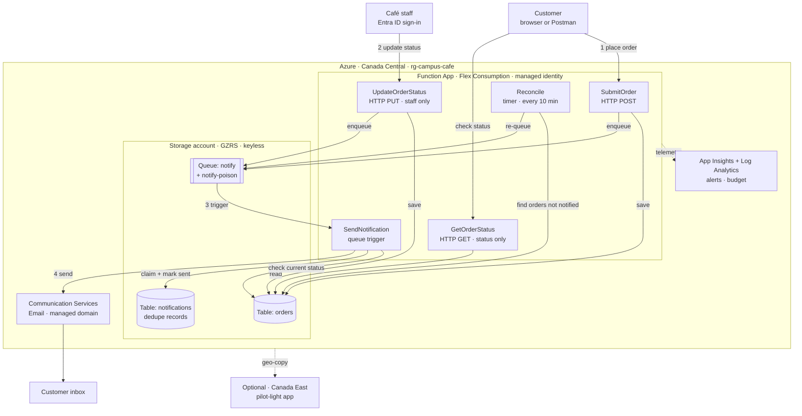
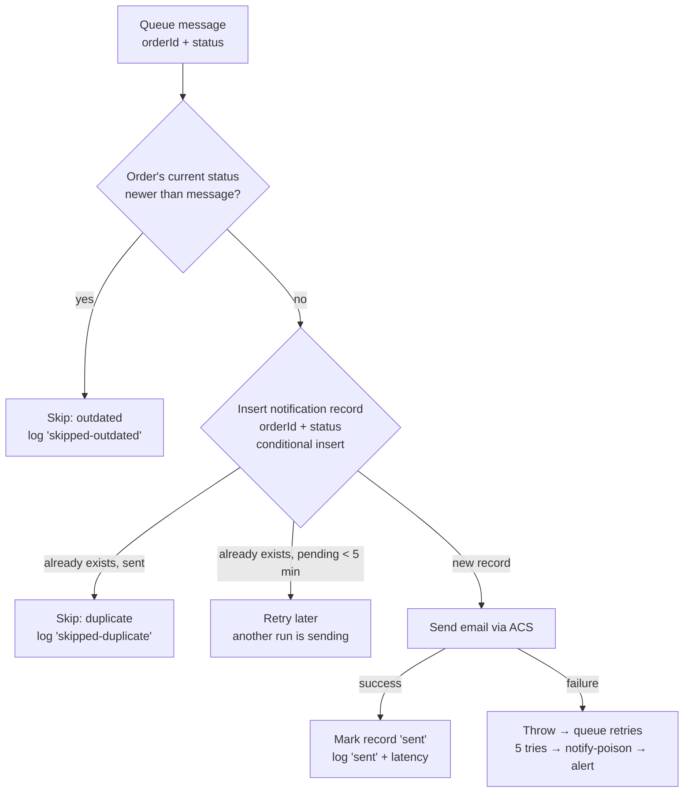
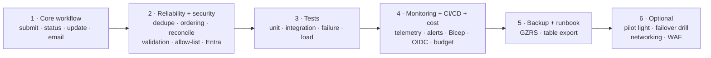

# Campus Café — Serverless Order Tracking on Azure

**Project proposal v3 (draft for review)** · Group 6 · George Brown College · Work Integrated Project · October 2026

> Draft in Markdown. Once the team agrees, it becomes the final PDF.
> Diagrams use Mermaid. They render on GitHub and in VS Code with a Mermaid preview extension.

---

## 0. What changed from v2, and why

| # | Problem in v2 | Change in v3 | Priority |
|---|---|---|---|
| 1 | Over-engineered | Core order lifecycle first. Advanced infrastructure moves to "Optional". | — |
| 2 | Too much disaster recovery | Keep GZRS storage, table backup, Bicep redeploy and runbook. Canada East pilot light becomes **optional**. | Should / Optional |
| 3 | No real order tracking | Add `GET /api/orders/{id}`: returns status only, no email. Order IDs are random GUIDs. Optional simple status page. | Must |
| 4 | Duplicate emails possible | Notification record per order + status, claimed with a conditional insert before sending. | Must |
| 5 | Emails can arrive out of order | `SendNotification` checks the order's current status first and skips outdated messages. | Must |
| 6 | Order saved but queue message lost | Retry the enqueue, plus a timer function that re-queues orders still waiting for a notification. | Must |
| 7 | Weak staff authentication | Entra ID sign-in for staff. Demo fallback: function key kept out of Git and rotated after the demo. | Must |
| 8 | Too many security items shown | Focus on managed identity, RBAC, HTTPS, validation, secure CI/CD. WAF, VNet and private endpoints deferred. | Must / Optional |
| 9 | Cost estimate too optimistic | Budget alerts at 50% and 100% of $5, a weekly cost check, and prices confirmed in the calculator. The estimate stays labelled "expected", not guaranteed. | Should |
| 10 | Email service limits | Create the ACS Email resource **before 23 Oct 2026**. Test quotas early. Fallback: `EMAIL_MODE=log`. | Must (urgent) |
| 11 | Weak testing | Unit, integration, failure-simulation and light load tests. | Must |
| 12 | Weak app-level monitoring | Log `orderId`, status changes, notification outcome and processing time. KQL queries and alerts on top. | Should |
| 13 | Anyone's email can be used | Allow only one email domain (e.g. `@georgebrown.ca`) or named demo accounts, plus per-email throttling. | Must |
| 14 | DR targets unproven | RTO ≤ 4 h and RPO in minutes are **targets** until a test proves them. | Should |
| 15 | Too much work before the app works | New build order: core workflow → reliability/security → tests → monitoring/CI/CD → backup → optional DR. | — |

---

## 1. Overview

A campus café needs to take customer orders and keep customers informed. Customers place an order and can **check its status at any time**. Staff move each order through four statuses: **Accepted → Preparing → Ready for pickup → Collected**. The customer also gets an email for the first three. Collected closes the order with no email.

**Final direction:** keep Azure Functions + Storage Queue + Table Storage. Simplify the infrastructure, strengthen reliability, and finish the whole order lifecycle first.

> A fully working, tested serverless system beats a complex, half-built one.

---

## 2. Scope

**In scope**
- Place an order (API)
- Check order status (API, optional simple page)
- Staff status updates (signed-in staff only)
- 3 customer emails, no duplicates, never out of order
- Logs, alerts, tests, CI/CD, backup and recovery runbook

**Out of scope:** payments, customer accounts, mobile app, multi-region active-active.

---

## 3. Architecture (rough sketch)

**Functions: 5**
- 3 from v1.
- `GetOrderStatus` (tracking).
- `Reconcile` (a small timer function that fixes lost queue messages).

**Storage: 1 account**
- 2 tables: `orders` and `notifications`.
- 1 queue: `notify`, with the automatic `notify-poison`.

---

## 4. How a notification is sent safely

**Rules**
- **No duplicates (#4).** Table Storage rejects inserting a row that already exists (HTTP 409). Only one run can claim `orderId + status`.
- **No outdated emails (#5).** Storage queues don't guarantee order. Each message carries a status rank (Accepted 1, Preparing 2, Ready 3). If the order is already further along, the old message is skipped.
- **No lost notifications (#6).** `SubmitOrder` and `UpdateOrderStatus` save first, then enqueue with retry. If the enqueue still fails, `Reconcile` finds orders whose current status has no `sent` record after 5 minutes and re-queues them.

---

## 5. Order tracking (#3)

- `GET /api/orders/{id}` returns `{ orderId, status, updatedAt }` only, never the email.
- `orderId` is a random GUID, so other orders can't be guessed.
- Anonymous, but throttled.
- Optional: one simple HTML status page that calls this API (Static Web Apps Free).

---

## 6. Security (focused, #7, #8, #13)

| Must | Should | Optional / later |
|---|---|---|
| Managed identity + RBAC, keyless storage | Key Vault for the ACS secret | VNet integration |
| HTTPS only, TLS 1.2 | Defender for Cloud free tier | Private endpoints |
| Input validation, size limits, fixed email templates | Azure Policy (Canada only, TLS) + delete locks | Front Door + WAF |
| Email allow-list (one domain or demo accounts) + throttling per IP and per email | Activity Log alerts on role changes | |
| Staff sign-in with Entra ID (fallback: function key, kept out of Git, rotated after demo) | | |
| Secure CI/CD: GitHub OIDC (no stored secrets), secret scanning, branch protection | | |

Note: network rules apply to the whole Function App. They can't protect only the staff endpoint, so staff protection comes from sign-in.

---

## 7. Testing (#11)

| Type | What we prove |
|---|---|
| Unit | Status rules (only the next status allowed), input validation, allow-list, dedupe and outdated-skip logic |
| Integration | Full flow locally with Azurite, then a smoke test on Azure |
| Failure simulation | Email fails → retries → poison queue → alert fires. Enqueue fails → `Reconcile` fixes it. Duplicate message → one email. Out-of-order message → skipped. |
| Light load | Small burst of orders from a laptop with `EMAIL_MODE=log`, to stay under the email cap. Check the 5-instance cap and latency. |

---

## 8. Observability (#12)

**Logged on every step:**
- `orderId`
- status from → to
- notification outcome: `sent`, `skipped-duplicate`, `skipped-outdated` or `failed`
- enqueue-to-sent latency

**Queries:**
- full timeline of one order
- failures per hour
- average notification latency

**Alerts:**
- function failures ≥ 1 in 5 minutes
- poison-queue messages
- budget 50% / 100%

---

## 9. Backup and recovery (#2, #14)

**Should**
- GZRS storage: copies data across zones and to Canada East.
- Nightly export of the `orders` table to a backup storage account.
- Bicep redeploy of the full stack from GitHub.
- A written recovery runbook:
  1. Detect the outage and check Last Sync Time.
  2. Fail over the storage account.
  3. Redeploy the app with Bicep.
  4. Point clients to the new URL and run `Reconcile`.

**Optional**
- Canada East pilot-light app (stopped, about $0 idle).
- Planned-failover drill on a test storage account.

**Targets (not yet proven):** RTO ≤ 4 h, RPO in minutes. Tested before we claim them.

---

## 10. Cost (#9)

**Expected under ~$2/month on Azure for Students. This is an estimate, not a guarantee.**
- **Budget:** $5, with alerts at 50% and 100%. Budgets on a student subscription are still to be confirmed.
- **Checks:** a weekly look at Cost Management, and prices confirmed in the Azure Pricing Calculator before the demo.
- **Biggest unknowns:**
  - log-search alerts (~$0.50+/month each, optional)
  - storage transactions
  - email volume

---

## 11. Email service (#10)

- **Urgent:** Microsoft limits new ACS onboarding from **23 Oct 2026**. Create the Email resource now.
- **Managed-domain limits:** 5 emails/min and 10/hour. Demos stay under about 3 orders/hour. Tests use `EMAIL_MODE=log`.
- **Retirement:** ACS Email retires 30 Sep 2028. Email stays behind one function, so a swap later touches one place.

---

## 12. Build order and priorities (#15)

| Must do | Should do | Optional |
|---|---|---|
| Core workflow + order tracking | Bicep + CI/CD | Canada East pilot light |
| Duplicate and out-of-order handling, reconcile | Monitoring + custom telemetry | Failover drill |
| Staff security + email allow-list | Cost controls | VNet, private endpoints |
| Tests | Backup + recovery runbook | Front Door + WAF |
| ACS Email resource before 23 Oct | Key Vault, Defender free tier, Policy | |

---

## 13. Open decisions for the team

1. Email allow-list: `@georgebrown.ca` only, or named demo accounts?
2. Tracking: API only, or API + simple HTML page?
3. Staff sign-in: Entra ID now, or function key for the first demo?

## 14. To confirm in the Azure portal

- Flex Consumption in Canada Central (and Canada East if the pilot light is used)
- GZRS available in Canada Central
- Built-in Entra sign-in works on Flex Consumption (else validate the token in code)
- Budgets work on the Azure for Students subscription

---

*References (unchanged from v2): Microsoft Learn — Storage DR and failover, Storage redundancy, Functions reliability, Functions networking, Functions connections and roles, ACS service limits, ACS retirement guide. Icons for the final PDF: Microsoft Azure Public Service Icons V24 (`Azure_Public_Service_Icons_V24.zip`).*
