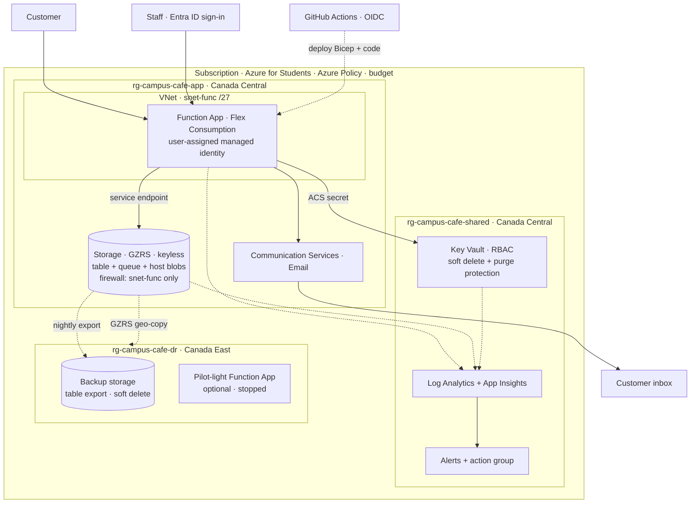
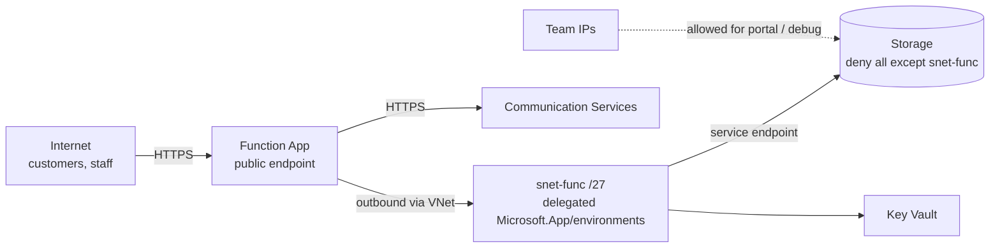

# Campus Café — Well-Architected Serverless Order Tracking on Azure

**Project proposal v4 (draft)** · Group 6 · George Brown College · Work Integrated Project · October 2026

> Focus: cloud infrastructure. The app stays small; the design is judged on identity, security, reliability, disaster recovery, governance, operations and cost.

---

## 1. Summary

Customers place a café order and track it. Staff move it through **Accepted → Preparing → Ready → Collected**. Customers get an email for the first three.

| Keep simple | Make strong |
|---|---|
| 4 functions · 1 table · 1 queue · 1 email service | Identity, network, data protection, governance, monitoring, recovery |

---

## 2. Application (minimal)

| Function | Trigger | Job |
|---|---|---|
| `SubmitOrder` | HTTP POST (public, throttled) | Validate, check email allow-list, save `Accepted`, enqueue |
| `GetOrderStatus` | HTTP GET (public, throttled) | Return status only (GUID order id, no email) |
| `UpdateOrderStatus` | HTTP PUT (staff, Entra ID) | Allow only the next status, save, enqueue |
| `SendNotification` | Queue `notify` | Skip outdated or already-sent status, send email, set flag |

- **Data:** one table `orders`, one row per order: status, email, `notified_<status>` flags. Flags are updated with an ETag check, so a retry never sends twice.
- **Failures:** 5 tries, then `notify-poison` plus an alert.

---

## 3. Infrastructure layout

**3 resource groups, split by lifecycle:**
- `app`: the workload.
- `shared`: monitoring and secrets, which outlive the app.
- `dr`: backup in another region.

---

## 4. Well-Architected design by pillar

### 4.1 Identity
| Who / what | Identity | Access |
|---|---|---|
| Function App | User-assigned managed identity | Storage: Blob Data Owner, Queue + Table Data Contributor. Key Vault: Secrets User |
| Staff | Entra ID group `grp-cafe-staff`, MFA via security defaults | Only `UpdateOrderStatus` |
| Team | Entra group `grp-cafe-admins` | Contributor on the 3 resource groups. Storage data roles for debugging |
| GitHub Actions | Entra app with OIDC federation (no stored secret) | Contributor on `app` resource group only |
| Customers | Anonymous | Submit + status only, throttled, email allow-list |

**Rules:**
- No shared keys: storage shared-key access is off.
- No secrets in code or Git.
- Every role is the smallest one that works.

### 4.2 Security (defence in depth)
| Layer | Control |
|---|---|
| Edge / API | HTTPS only, TLS 1.2, input validation, size limits, throttling per IP and per email, email domain allow-list, fixed templates |
| Network | VNet integration (`snet-func` /27). Storage firewall allows only that subnet (service endpoint) plus team IPs. Inbound to the app stays public (it is an API). |
| Data | Encrypted at rest (default) and in transit. Only email stored as personal data, never logged. Old orders purged after 30 days. |
| Secrets | ACS connection string in Key Vault, read by Key Vault reference |
| Detect | Defender for Cloud free tier (secure score). Diagnostic logs from every resource. Activity Log alerts on role changes and deletes. |

**Deferred (cost):** private endpoints, Front Door + WAF, paid Defender plans.

### 4.3 Reliability
- Stateless functions, queue between HTTP and email, retries + poison queue.
- Idempotent and ordered notifications (status flags + ETag).
- GZRS storage survives a zone outage. Key Vault is zone-redundant by default.
- Azure Service Health + Resource Health alerts.

### 4.4 Disaster recovery
| Item | Choice |
|---|---|
| Strategy | Backup and restore. Pilot light is optional. |
| Data | GZRS geo-copy to Canada East + nightly table export to backup storage |
| Rebuild | Whole stack from Bicep in GitHub, into any region |
| Targets | RTO ≤ 4 h, RPO in minutes. Targets until proven by a drill. |
| Runbook | 1 Detect, check Last Sync Time → 2 Fail over storage → 3 Deploy app with Bicep → 4 Switch clients, re-send missed emails |
| Test | Redeploy drill to Canada East. Planned failover on a test storage account (no data loss). |

### 4.5 Governance
- **Azure Policy (built-in), subscription scope:**
  - allowed locations Canada Central + Canada East
  - required tags `app`, `env`, `owner`
  - storage secure transfer
  - storage shared-key access disabled
  - Key Vault soft delete
- **Other controls:**
  - `CanNotDelete` locks on the `shared` and `dr` groups.
  - Naming standard: Microsoft Cloud Adoption Framework prefixes (`rg-`, `func-`, `st`, `kv-`, `log-`).
  - All infrastructure as code (Bicep). No portal-only changes.

### 4.6 Operational excellence
- **CI/CD:** GitHub Actions in 3 stages: build + test → Bicep what-if → deploy. Branch protection, secret scanning, Dependabot.
- **One Log Analytics workspace.** Every log line carries `orderId`.
- **Alerts:**
  - function failures
  - poison message
  - Key Vault access denied
  - budget
- **Runbooks:** recovery, key rotation, adding or removing staff.

### 4.7 Cost optimization
| Item | Expected monthly |
|---|---|
| Functions (Flex, scale to zero) | Within free grant |
| Storage GZRS + backup | Cents |
| Email | $0.00025 per email |
| Logs | Within 5 GB free, daily cap set |
| Key Vault | Cents |
| VNet + service endpoints | Free |
| **Total** | **Under ~$2, not guaranteed** |

- **Guards:** budget alerts at 50% and 100% of $5, max 5 instances, a weekly cost check.
- **Deferred:** anything with a monthly base fee.

### 4.8 Performance efficiency
- Per-function scaling on Flex.
- HTTP returns fast; email runs in the background.
- Partition key = date, so status lookups and backups stay cheap.

---

## 5. Network view

---

## 6. Build order

| Phase | Deliver |
|---|---|
| 1 Foundation | Resource groups, Policy, tags, Log Analytics, Key Vault, identity, budget (Bicep) |
| 2 Core app | 4 functions, table, queue, email |
| 3 Lock down | VNet + storage firewall, keyless, Entra staff sign-in, allow-list, throttling |
| 4 Operate | Diagnostics, alerts, CI/CD pipeline, tests (unit, integration, failure simulation) |
| 5 Recover | GZRS, table export, runbook, redeploy drill |
| 6 Optional | Pilot light, private endpoints, WAF |

---

## 7. Risks and to confirm

- **ACS Email:** onboarding limited from 23 Oct 2026, managed domain capped at 10 emails/hour, retires 2028. Fallback: `EMAIL_MODE=log`.
- **Storage firewall:** check that GitHub deployment and the portal still work when storage is locked (trusted services, team IPs).
- **Still to confirm in the portal:**
  - Flex Consumption in Canada Central
  - GZRS in Canada Central
  - Entra sign-in on Flex
  - budgets on the student subscription

---

## 8. Well-Architected scorecard

| Pillar | Done in v4 | Deferred (why) |
|---|---|---|
| Identity | Managed identity, Entra groups, OIDC, no keys | Privileged Identity Management (licence) |
| Security | Layered controls, VNet + service endpoints, Key Vault | Private endpoints, WAF (cost) |
| Reliability | Queue, retries, idempotency, GZRS | Zone-redundant compute (cost) |
| Disaster recovery | Backup, Bicep rebuild, runbook, drill | Automatic failover (cost) |
| Governance | Policy, tags, locks, naming, IaC | Management groups (single subscription) |
| Operations | CI/CD, central logs, alerts, runbooks | — |
| Cost | Free tiers, budget alerts, caps | — |

*Icons for the final PDF: Microsoft Azure Public Service Icons V24 (`Azure_Public_Service_Icons_V24.zip`).*
