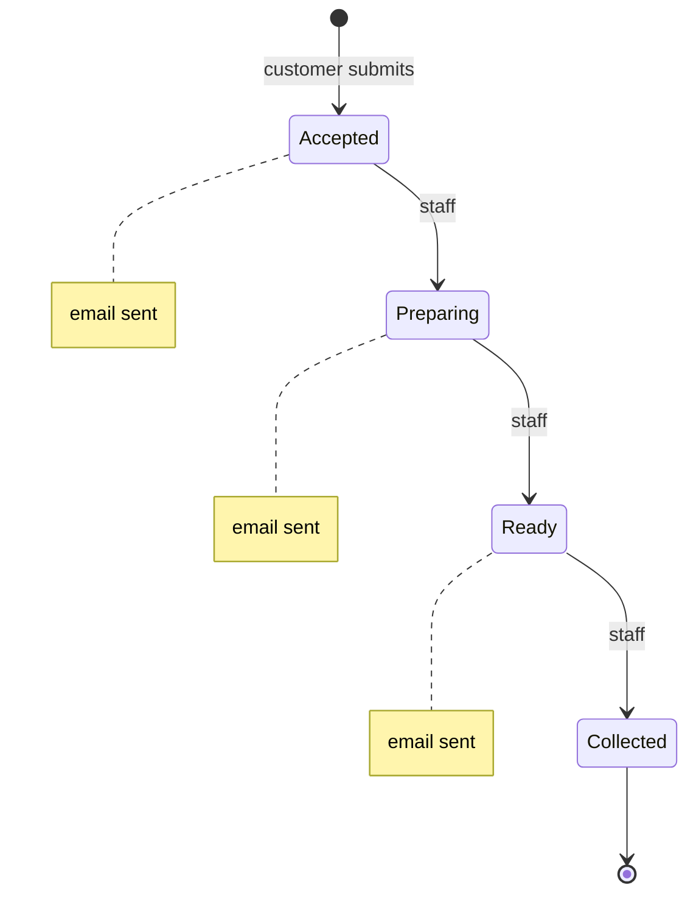
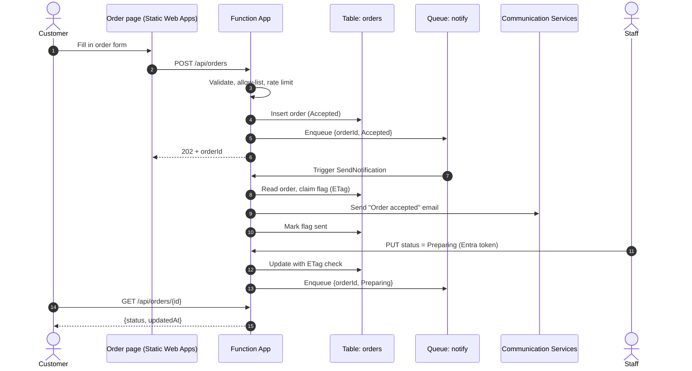
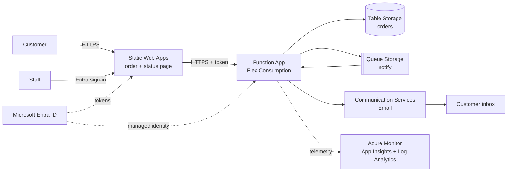
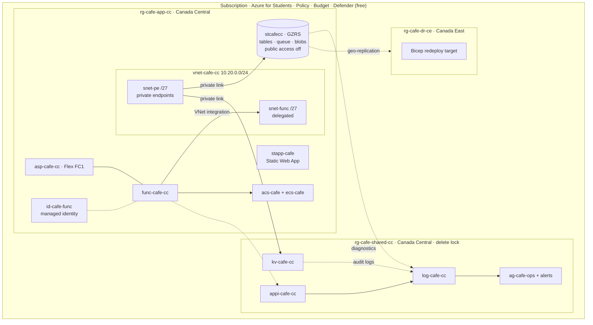
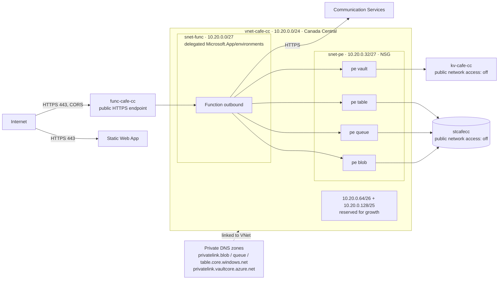
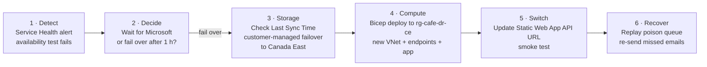
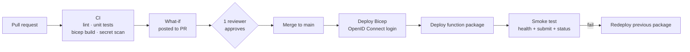

# Campus Café — Serverless Order Tracking

**Azure infrastructure proposal** · Group 6 · George Brown College · Work Integrated Project · October 2026

> Draft for review. Diagrams are rough Mermaid sketches; the final PDF will redraw them with official Azure icons.

---

## 1. Project overview

### 1.1 Business problem
The campus café takes orders at the counter. At peak times (8–10 AM, 12–2 PM):
- Customers queue twice: once to order, once to ask "is mine ready?".
- Staff are interrupted to answer status questions.
- Nothing records how long orders take or where delays happen.

### 1.2 Objectives
| # | Objective | Measure of success |
|---|---|---|
| O1 | Customers order online and track their order | Order placed in < 2 s. Status visible at any time. |
| O2 | Customers are told when the order moves forward | Email for Accepted, Preparing and Ready. No duplicates, never out of order. |
| O3 | Only café staff can change an order | Every status change is tied to a signed-in staff identity. |
| O4 | Customer data is protected | No public data endpoints. No stored keys. Email addresses purged after 30 days. |
| O5 | The service survives failures | Recovery from a regional outage in ≤ 4 h (target) |
| O6 | Running cost stays near zero when idle | Expected under ~$5/month normal running. Budget alerts in place. |

### 1.3 Scope
| In scope | Out of scope |
|---|---|
| Customer order page and order API | Payments and refunds |
| Status tracking: Accepted → Preparing → Ready for Pickup → Collected | Customer accounts and loyalty |
| Staff status updates (signed-in staff only) | Mobile apps |
| Email notifications | Multi-region active-active |
| Infrastructure as code, CI/CD, monitoring, backup and recovery | Menu and inventory management |

### 1.4 Proposed solution
An event-driven, serverless application on Azure in **Canada Central**, with **Canada East** as the recovery region.
- **Azure Functions (Flex Consumption)** runs the API and background work. It scales to zero when idle.
- **Azure Storage** holds orders (Table) and decouples work (Queue).
- **Azure Communication Services** sends the emails.
- **Microsoft Entra ID** signs in staff and authenticates every service-to-service call, so the design holds no keys.
- **Private endpoints** keep all data traffic inside a virtual network.
- **Bicep** and **GitHub Actions** build and deploy everything, so the whole system can be rebuilt in another region from code.

---

## 2. Application workflow

### 2.1 Components
| Function | Trigger | Responsibility |
|---|---|---|
| `SubmitOrder` | HTTP POST `/api/orders` | Validate input and allow-listed email, check per-IP and per-email rate limits, save order as **Accepted**, enqueue notification, return `orderId` |
| `GetOrderStatus` | HTTP GET `/api/orders/{id}` | Return status and timestamps only. Never returns the email. |
| `UpdateOrderStatus` | HTTP PUT `/api/orders/{id}/status` | Staff only (Entra app role `Cafe.Staff`). Allow only the next status, save with concurrency check, enqueue notification. |
| `SendNotification` | Queue `notify` | Send the email for that status exactly once, skip outdated messages |
| `NightlyMaintenance` | Timer, 03:00 UTC | Export order snapshot to the backup container, purge orders older than 30 days, clear old rate-limit rows |

Flex Consumption does not support time-zone settings, so all schedules run in UTC.

### 2.2 Status lifecycle



- Moves are forward-only, one step at a time. A skip or a backward move returns HTTP 409.
- **Collected** closes the order; no email is sent.

### 2.3 Order-processing flow



### 2.4 Notification guarantees
| Risk | Control |
|---|---|
| Same email sent twice (queue delivers at least once) | Per-status flag on the order row: `pending → sending → sent`. The flag is claimed with an ETag (optimistic concurrency) before sending. Only one worker can claim it. |
| Emails out of order (queues don't guarantee order) | Each message carries the status rank. If the order has already moved further, the message is skipped and logged as `skipped-outdated`. |
| Email service down | Function throws → queue retries 5 times → message moves to `notify-poison` → alert fires → team replays it after the fix. |
| Worker crashes mid-send | A flag stuck in `sending` for over 5 minutes is retried on the next delivery. |

### 2.5 Data model (Table `orders`)
| Field | Example | Notes |
|---|---|---|
| PartitionKey / RowKey | `{orderId}` / `order` | Random GUID, so IDs can't be guessed. Point reads are fast and cheap. |
| `items`, `pickupName` | `["latte"]`, `"Sam"` | Validated against a fixed menu list |
| `email` | `s123@georgebrown.ca` | Only personal data stored. Never logged. Purged after 30 days. |
| `status`, `statusRank` | `Preparing`, `2` | |
| `notifyAccepted/Preparing/Ready` | `sent` | Exactly-once flags |
| `updatedBy` | staff object ID | Audit of who changed what |

A second table, `ratelimits`, stores hourly counters per IP and per email.

---

## 3. Azure infrastructure architecture

### 3.1 High-level architecture



### 3.2 Resource inventory
| Resource group | Resource | Name | Purpose |
|---|---|---|---|
| `rg-cafe-app-cc` | Flex Consumption plan | `asp-cafe-cc` | Serverless compute (Linux, FC1) |
| | Function App | `func-cafe-cc` | 5 functions, HTTPS only, TLS 1.2+ |
| | User-assigned managed identity | `id-cafe-func` | The app's only identity. No keys. |
| | Storage account (GZRS) | `stcafecc` | Table `orders` + `ratelimits`, queue `notify`, blob `deployments`, `backups` |
| | Static Web App (Free) | `stapp-cafe` | Customer and staff pages |
| | Communication Services + Email Service | `acs-cafe`, `ecs-cafe` | Email sending, data location Canada |
| | Virtual network | `vnet-cafe-cc` | Private traffic (see §4) |
| | Private endpoints ×4 + private DNS zones ×4 | `pe-stcafecc-{blob,queue,table}`, `pe-kv-cafe` | Private access to storage and Key Vault |
| `rg-cafe-shared-cc` | Key Vault (RBAC mode) | `kv-cafe-cc` | Secrets that can't be removed (see §5.4) |
| | Log Analytics workspace | `log-cafe-cc` | Central logs, 30-day retention, daily cap |
| | Application Insights | `appi-cafe-cc` | App telemetry (workspace-based) |
| | Action group + alert rules | `ag-cafe-ops` | Email the team on incidents |
| `rg-cafe-dr-ce` | Empty by design | — | Target for a Bicep redeploy in Canada East during recovery |
| Subscription | Policy assignments, budget, Defender for Cloud (free tier), Activity Log export | — | Guardrails and visibility |

**Why three resource groups:**
- **App:** the workload. It can be torn down and redeployed freely.
- **Shared:** logs and secrets that must outlive any single deployment. Protected by a delete lock.
- **DR:** keeps recovery deployments apart and easy to clean up after a drill.

### 3.3 Infrastructure layout



### 3.4 Communication flows
| From → To | Path | Authentication |
|---|---|---|
| Browser → Static Web App | Public HTTPS | None (customer), Entra ID (staff) |
| Browser → Function App | Public HTTPS, CORS limited to the Static Web App origin | Anonymous with rate limits (customer); Entra bearer token with `Cafe.Staff` role (staff) |
| Function App → Storage | VNet → private endpoint | Managed identity (RBAC) |
| Function App → Key Vault | VNet → private endpoint | Managed identity |
| Function App → Communication Services | Microsoft backbone, HTTPS | Managed identity |
| All resources → Log Analytics | Diagnostic settings | Platform-managed |
| GitHub Actions → Azure | Azure Resource Manager | OpenID Connect federation, no stored secret |

---

## 4. Network architecture

### 4.1 Topology



### 4.2 Design decisions
| Decision | Reason |
|---|---|
| **Two subnets** | Flex Consumption needs its own `/27` subnet delegated to `Microsoft.App/environments`. That subnet can't hold private endpoints or service endpoints. |
| **Private endpoints for storage (blob, queue, table) and Key Vault** | Data never crosses the public internet. Public network access on both is **disabled**, which removes the biggest data-exposure risk. |
| **Private DNS zones linked to the VNet** | The function resolves `stcafecc.table.core.windows.net` to a private IP automatically, with no code change. |
| **NSG on `snet-pe`** | Allows HTTPS 443 from `snet-func` only and denies other VNet inbound traffic, to limit lateral movement. |
| **Function App inbound stays public** | It is a customer-facing API. It's protected by HTTPS, CORS, input validation, rate limiting and Entra ID for staff routes. |
| **`/24` with room to grow** | Space for a future Front Door origin subnet, a jump host or a second app, without re-addressing. |
| **No NAT gateway, VPN or firewall** | No on-premises link and no outbound IP allow-listing needed, so ~$30+/month avoided. |

### 4.3 Admin access with public access off
- Team access to stored data goes through Azure Monitor logs and the `GetOrderStatus` API, not the storage portal.
- **Break-glass:** a Bicep parameter `adminIpAllowList` temporarily opens storage and Key Vault to one team IP. Changing it is logged in the Activity Log and alerted.
- **Deployments:** code deploys through the Function App's management endpoint, which stays reachable. The platform then writes the package to the private storage account over the VNet. This must be confirmed in Phase 3 (§9.3).

### 4.4 Production upgrade path (not built now)
Azure Front Door Premium with WAF in front of the API (bot and rate rules) plus a private endpoint for the Function App inbound. This costs about $330/month, so it is out of student budget and documented as the next step.

---

## 5. Identity and security

### 5.1 Identities and access
| Who / what | Identity | Access granted (least privilege) |
|---|---|---|
| Function App | `id-cafe-func` (user-assigned managed identity) | On `stcafecc`: Storage Blob Data Owner (host requirement), Queue Data Contributor, Table Data Contributor. On `kv-cafe-cc`: Key Vault Secrets User. On `acs-cafe`: email send role scoped to that one resource. |
| Café staff | Entra users in group `grp-cafe-staff`, app role `Cafe.Staff` on app registration `app-cafe-api` | Only `UpdateOrderStatus` |
| Platform admins (2 members) | Group `grp-cafe-admins` | Contributor on the 3 resource groups |
| Team (3 members) | Group `grp-cafe-devs` | Reader + Monitoring Reader + Log Analytics Reader. No data-plane access. |
| GitHub Actions | Federated credential (OpenID Connect) on a deployment identity, limited to `main` branch and `prod` environment | Contributor on `rg-cafe-app-cc`. Role Based Access Control Administrator **with a condition** that it may assign only the 5 data roles above. |
| Customers | Anonymous | Submit an order and read status by unguessable ID. Rate-limited. |

**Rules:**
- **Groups, not people.** Roles are assigned to Entra groups. Joining or leaving the team is a group change, not a role change.
- **MFA for every admin.** Security defaults are on, so the five team accounts must use MFA.
- **No standing Owner.** Only the subscription holder keeps Owner, as break-glass. Daily work uses Contributor.
- **Quarterly access review.** The team lead exports role assignments and removes anything unused.

### 5.2 Authentication flows
- **Staff:** sign in on the Static Web App page with MSAL. The page calls the API with a bearer token. Function App built-in authentication validates the token. `UpdateOrderStatus` also checks for the `Cafe.Staff` role claim.
- **Services:** every Azure call uses `DefaultAzureCredential` with the managed identity. Storage **shared-key access is disabled**, so a leaked key would be useless because no keys exist.

### 5.3 Defence in depth
| Layer | Controls |
|---|---|
| Edge | HTTPS only, TLS 1.2 minimum, HSTS on the Static Web App, CORS allow-list |
| Application | Input schema validation, 4 KB body limit, fixed menu list, email domain allow-list (`@georgebrown.ca`), fixed email templates (no user text in emails), rate limits: 5 orders/hour per IP and 3 per email |
| Identity | Entra ID, managed identity, no secrets in code or Git, GitHub OpenID Connect |
| Network | Private endpoints, public access off on data services, NSG on the endpoint subnet |
| Data | Encryption at rest (Microsoft-managed keys, 256-bit AES) and in transit (TLS). Personal data minimised to one field. 30-day purge. Email never written to logs. |
| Detection | Defender for Cloud free tier (secure score and recommendations), Key Vault and storage audit logs, Activity Log alerts |

### 5.4 Secrets management
The design is keyless by default. Key Vault holds only what can't be removed:
- the API key for a **fallback email provider**, if Azure Communication Services onboarding is blocked (see §10)
- any future third-party credential

**Key Vault settings:**
- RBAC permission model.
- Soft delete (90 days) and purge protection.
- Public access off.
- Secrets are read through **Key Vault references** in app settings, so code never sees the vault.
- Secret expiry dates are set, with an alert 30 days before expiry.

### 5.5 Threats considered
| Threat | Mitigation |
|---|---|
| Spoofing a staff member | Entra ID with MFA, role claim checked in code |
| Tampering with orders | Only staff can update. ETag concurrency. `updatedBy` audit field. |
| Order data leak | No email in API responses, random IDs, private data plane |
| Email spam through our app | Domain allow-list, fixed templates, rate limits |
| Bill shock from abuse | Rate limits, instance cap, budget alerts |
| Secret leak | No keys exist. GitHub secret scanning. OpenID Connect deploys. |

---

## 6. Reliability and disaster recovery

### 6.1 Availability and fault tolerance
| Failure | Effect | Built-in protection |
|---|---|---|
| Function instance crash | One request fails | Stateless functions. Platform replaces the instance. Queue work is retried. |
| Email service slow or down | Emails delayed | Queue buffers. 5 retries, then poison queue and alert. Order taking is unaffected. |
| Duplicate or out-of-order message | — | Exactly-once flags and rank check (§2.4) |
| Availability-zone outage | Storage unaffected | GZRS keeps 3 synchronous copies across zones |
| Bad deployment | App errors | Smoke test gates the pipeline. Roll back by redeploying the previous package (Flex has no deployment slots). |
| Regional outage | Service down | Recovery to Canada East (§6.3) |

**Availability target:** 99.5% during café hours (7 AM–7 PM). It is measured by an Application Insights availability test on `GET /api/health` every 5 minutes.

### 6.2 Backup strategy
| Data | Method | Retention | Protects against |
|---|---|---|---|
| Orders table | `NightlyMaintenance` exports a JSON snapshot to the `backups` blob container | 30 days. Versioning, soft delete and a time-based immutability policy. | Accidental deletion, bad code corrupting data |
| All storage data | GZRS geo-replication to Canada East (asynchronous) | Continuous | Regional disaster |
| Infrastructure | Bicep in GitHub | Every commit | Lost or misconfigured resources |
| Secrets | Key Vault soft delete + purge protection | 90 days | Accidental deletion |
| Storage account | `CanNotDelete` lock + Azure Policy | — | Whole-account deletion |

### 6.3 Recovery targets and strategy
| Metric | Target | Basis |
|---|---|---|
| **RTO** (time to restore service) | ≤ 4 hours | Bicep redeploy ~30 min + storage failover ~1 h + verification. Proven only after the drill. |
| **RPO, regional disaster** | Minutes | GZRS is usually seconds to minutes behind. No Microsoft SLA for table or queue replication. |
| **RPO, data corruption** | ≤ 24 hours | Nightly snapshot |

**Strategy: backup and restore with infrastructure as code.** Running a warm standby would double cost for a café service that can tolerate a few hours of outage. During that time the café falls back to counter ordering.

### 6.4 Recovery runbook (regional outage)



**Notes:**
- An **unplanned failover** converts the account to locally redundant storage (LRS) and may lose the last minutes of writes. After recovery, the team re-enables geo-redundancy.
- Static Web Apps is a global service, so only its API setting changes.
- Key Vault data is replicated to the paired region by Microsoft. The DR Bicep creates a fresh vault and copies the few secrets from the runbook's secure store.

### 6.5 Business continuity
- **Manual fallback:** paper or counter orders. Staff get a one-page "service down" card.
- **Communication:** a status banner on the Static Web App, toggled by a config file.
- **Recovery drill once per term:**
  - redeploy the full stack to Canada East from Bicep
  - run a **planned failover** on a test storage account (no data loss)
  - restore a snapshot into a test table
  - record the actual RTO and RPO.

---

## 7. Governance and cost management

### 7.1 Resource organization and naming
- **Naming:** Microsoft Cloud Adoption Framework prefixes plus the region code: `rg-`, `func-`, `asp-`, `st`, `kv-`, `log-`, `appi-`, `vnet-`, `snet-`, `pe-`, `id-`, `ag-`.
- **Required tags on every resource:**

| Tag | Example |
|---|---|
| `app` | `campus-cafe` |
| `env` | `prod` / `dr-test` |
| `owner` | `group6` |
| `costCenter` | `gbc-t465` |
| `dataClass` | `personal` / `internal` |

### 7.2 Azure Policy (built-in definitions, subscription scope)
| Policy | Effect |
|---|---|
| Allowed locations: Canada Central, Canada East | Deny |
| Require tag `app`, `env`, `owner` on resource groups | Deny |
| Inherit tags from resource group | Modify |
| Storage accounts should disable public network access | Audit |
| Storage accounts should prevent shared key access | Deny |
| Secure transfer to storage accounts should be enabled | Deny |
| Key vaults should have soft delete and purge protection enabled | Audit |
| Function apps should only be accessible over HTTPS | Audit |
| Allowed resource types (only the types in §3.2) | Deny |

**Other guardrails:**
- `CanNotDelete` locks on `rg-cafe-shared-cc` and on the storage account.
- The subscription Activity Log is exported to Log Analytics for audit.

### 7.3 Change control
- **No portal changes in production.** All changes go through Bicep and pull requests.
- **Weekly drift check.** `az deployment what-if` runs each week; drift opens an issue.
- **Pull request approval.** Each pull request needs one approval from another team member.

### 7.4 Cost estimate (Canada Central, USD list prices, to confirm in the Azure Pricing Calculator)
| Item | Basis | Expected monthly |
|---|---|---|
| Functions Flex Consumption | Within monthly free grant (250k executions, 100k GB-s) | ~$0 |
| Storage GZRS (tables, queue, blobs, backups) | < 1 GB, low transactions | < $1 |
| Private endpoints ×4 | ~$0.01/hour each | ~$29 |
| Private DNS zones ×4 | ~$0.50/zone | ~$2 |
| Communication Services Email | $0.00025/email, ~1,000 emails | ~$0.25 |
| Log Analytics + App Insights | Within 5 GB free, daily cap 0.2 GB | ~$0 |
| Alerts | ~5 metric + 2 log alerts | ~$2 |
| Key Vault, Static Web Apps Free, VNet, NSG, Entra ID Free, Defender free tier | — | ~$0 |
| **Total, full private networking** | | **~$35** |
| **Total, build phases (private endpoints off)** | | **~$3** |

**Cost controls:**
- **Budget:** $40/month with alerts at 50%, 80% and 100% (actual) and 100% (forecast), sent to the action group.
- **Toggle:** a Bicep parameter `enablePrivateNetworking`. Off during Phases 1–2 (data protected by keyless identity auth). On from Phase 3 through grading. Then the stack is torn down.
- **Scale cap:** maximum instance count 40 per function group (Microsoft's lower guideline for HTTP apps), with zero always-ready instances.
- **Log cap:** Log Analytics daily cap with an alert when it is reached.
- **Reviews:** a weekly Cost Management check in the Friday stand-up, and a monthly review of Advisor cost recommendations.

**Deliberately not used:**
| Service | Approx. monthly cost |
|---|---|
| Front Door + WAF | ~$330 |
| Zone-redundant always-ready compute | ≥ 2 instances always on |
| Paid Defender plans | per resource |
| NAT gateway | ~$32 |

---

## 8. Operations and performance

### 8.1 Observability
| Signal | Source | Destination |
|---|---|---|
| Function logs, requests, dependencies, exceptions | Application Insights (workspace-based) | `log-cafe-cc` |
| Storage read/write/delete logs (table, queue, blob) | Diagnostic settings | `log-cafe-cc` |
| Key Vault audit events | Diagnostic settings | `log-cafe-cc` |
| Subscription Activity Log (role changes, deletes, policy) | Diagnostic settings | `log-cafe-cc` |
| Uptime | Availability test, every 5 min | Application Insights |

**Structured logging:**
- Every log line carries `orderId`, `operation`, `fromStatus → toStatus`, `outcome` and `durationMs`.
- Outcome is one of `sent`, `skipped-duplicate`, `skipped-outdated` or `failed`.
- Email addresses are never logged.

**Dashboard (Azure Workbook):**
- orders per hour
- average Accepted → Ready time
- email outcomes
- p95 API latency
- failures by function

### 8.2 Alerts → `ag-cafe-ops` (team email)
| Alert | Condition | Severity |
|---|---|---|
| Function failures | > 0 failed executions in 5 min | 2 |
| Notification gave up | Log query: final failure / poison message in 15 min | 1 |
| API slow | p95 `SubmitOrder` > 2 s over 15 min | 3 |
| Availability | Health test fails 2 of 3 locations | 1 |
| Access denied spike | Storage or Key Vault 403s > 10 in 15 min | 2 |
| Security change | Role assignment, policy change or resource delete (Activity Log) | 2 |
| Platform | Service Health or Resource Health event in Canada Central | 1 |
| Cost | Budget thresholds | 3 |

### 8.3 Runbooks
- **Poison queue replay:** inspect the message, fix the cause, move it back to `notify`.
- **Rotate the fallback email key:** Key Vault new version → app picks it up automatically.
- **Add or remove staff:** change the `grp-cafe-staff` membership.
- **Regional recovery:** §6.4.
- **Alert triage:** owner, first checks, escalation.

### 8.4 Scalability and performance
| Area | Approach |
|---|---|
| Scaling | Flex Consumption per-function scaling. HTTP functions and the queue function scale independently, so an email backlog never slows ordering. |
| Fast response | `SubmitOrder` writes one row and one message, then returns 202. The email is sent in the background. |
| Cold start | Accepted at café scale. If needed, 1 always-ready instance on HTTP functions during peak hours (small hourly cost). |
| Data access | Point reads by `orderId`, the cheapest and fastest table operation. No table scans on the hot path. |
| Instance memory | 2,048 MB default. Load tests decide whether 512 MB is enough, which would cut cost per execution. |
| Email throughput | Managed domain allows 5 emails/min and 10/hour per subscription. Moving to a custom verified domain raises this to 30/min and 100/hour. |
| Load test | Azure Load Testing free tier or a k6 script: 50 orders/min for 10 min, with `EMAIL_MODE=log` to stay under the email cap |

---

## 9. Implementation strategy

### 9.1 Infrastructure as code
```
infra/
  main.bicep                 # subscription scope: RGs, policy, budget
  modules/
    network.bicep            # VNet, subnets, NSG, private DNS
    storage.bicep            # GZRS account, tables, queue, containers, lock
    privateEndpoints.bicep   # toggled by enablePrivateNetworking
    function.bicep           # plan, app, identity, settings, auth
    keyvault.bicep
    monitoring.bicep         # LAW, App Insights, diagnostics, alerts, workbook
    email.bicep
    rbac.bicep               # role assignments to groups and identity
  params/
    prod.cc.bicepparam
    dr.ce.bicepparam         # same templates, Canada East
```

### 9.2 CI/CD pipeline (GitHub Actions)



**Repository protection:**
- branch protection on `main`
- GitHub `prod` environment with a required reviewer
- Dependabot
- secret scanning with push protection

### 9.3 Delivery phases (five-member team, ~8 weeks)
| Phase | Weeks | Deliverables | Exit check |
|---|---|---|---|
| **1 · Foundation** | 1–2 | Subscription guardrails (Policy, budget, tags), Entra groups, GitHub OpenID Connect, shared RG (Log Analytics, App Insights, Key Vault), **Communication Services resource created immediately** | `what-if` clean, policy compliance visible |
| **2 · Core application** | 2–4 | Storage, Function App with managed identity, 5 functions, Static Web App pages, email working | End-to-end order → 3 emails in Azure |
| **3 · Secure** | 4–5 | VNet, private endpoints + DNS, public access off, NSG, staff sign-in + app role, rate limits, allow-list | Pen-test checklist: storage unreachable from internet, staff route rejects customer tokens, deploy still works |
| **4 · Operate** | 5–6 | Diagnostics everywhere, alerts, workbook, availability test, runbooks | Each alert fired once on purpose |
| **5 · Recover** | 6–7 | Nightly snapshot, immutability, locks, DR Bicep params, drill | Measured RTO/RPO recorded |
| **6 · Harden and present** | 7–8 | Load test, cost review, Defender recommendations closed, documentation | Secure score reviewed, demo rehearsed |

### 9.4 Team roles
| Role | Owns |
|---|---|
| **Cloud lead / architect** | Design decisions, Bicep `main`, reviews, final presentation |
| **Application developer** | 5 functions, data model, notification logic, unit tests |
| **Security & identity engineer** | Entra app and roles, RBAC module, Key Vault, Policy, threat table |
| **Network & reliability engineer** | VNet, private endpoints, DNS, backup, DR runbook and drill |
| **DevOps & monitoring engineer** | GitHub Actions, OpenID Connect, diagnostics, alerts, workbook, cost reports |

Each owner pairs with one other member on their area, so no single person is a single point of failure.

### 9.5 Testing
| Type | What it proves |
|---|---|
| Unit | Status transitions, validation, allow-list, rate limits, exactly-once and outdated-skip logic |
| Integration | Full flow locally with Azurite emulator, then in Azure |
| Security | Storage and Key Vault unreachable from the internet. Customer token rejected on staff route. No secrets in repo (scan). |
| Failure injection | Email returns errors → retries → poison → alert. Duplicate message → one email. Old message → skipped. |
| Load | 50 orders/min for 10 min, p95 < 2 s, no throttling errors |
| Recovery | Bicep redeploy to Canada East, snapshot restore, planned failover on test account |

### 9.6 Operational readiness checklist (go-live gate)
- [ ] All resources deployed from Bicep. No manual drift.
- [ ] Policy compliance ≥ 95%, Defender recommendations reviewed.
- [ ] Every alert tested and routed to the action group.
- [ ] Runbooks written and tried by someone other than the author.
- [ ] Recovery drill completed, actual RTO/RPO recorded.
- [ ] Budget and cost alerts active.
- [ ] Access review done. Only groups hold roles.

---

## 10. Risks and assumptions

| Risk | Impact | Mitigation |
|---|---|---|
| **Communication Services Email onboarding is limited for new customers from 23 Oct 2026, and the service retires 30 Sep 2028** | Can't send emails | Create the resource in Phase 1 week 1. Email sending is isolated in one function, so a fallback provider (key in Key Vault) needs one change. `EMAIL_MODE=log` for tests. |
| Managed-domain email limit (10/hour) | Demo emails delayed | Demo stays under 3 orders/hour. Load tests use log mode. |
| Private endpoints make portal debugging harder | Slower troubleshooting | Logs-first debugging, break-glass IP parameter |
| Student subscription limits (quota, budget feature, region availability) | Blocked deploys | Verify in week 1: Flex Consumption and GZRS in Canada Central and Canada East, budgets, Entra app registration rights |
| Deployment with storage locked down | Pipeline fails | Validate in Phase 3. Fallback: GitHub runner allow-listed temporarily. |
| Unplanned storage failover loses recent writes | A few minutes of orders lost | Accepted. Customers re-submit. Documented in the runbook. |

**Assumptions:**
- Peak load is about 200 orders/hour.
- Customers have campus email addresses.
- Staff have Entra accounts in the same tenant.
- The café accepts up to 4 hours of downtime, with a manual fallback.

---

## Appendix A — Proposed PDF layout

| Page | Content |
|---|---|
| 1 | Title, overview (problem, objectives, scope, solution), high-level architecture |
| 2 | Application workflow: status lifecycle, order-processing sequence, notification guarantees |
| 3 | Infrastructure layout diagram + resource inventory |
| 4 | Network topology diagram + design decisions |
| 5 | Identity and security: access table, defence layers, threats |
| 6 | Reliability and recovery: failure table, backup, RTO/RPO, runbook diagram |
| 7 | Governance and cost: policy, tags, cost table, controls |
| 8 | Operations: observability, alerts, scaling |
| 9 | Implementation: IaC layout, pipeline diagram, phases, roles, testing, readiness |
| 10 | Risks, assumptions, references, icon credits |

*References: Microsoft Learn — Azure Functions Flex Consumption plan and networking, Azure Storage redundancy and failover, private endpoints for Azure Storage, Azure Private Link pricing, Communication Services Email authentication and limits, Azure Policy built-in definitions. Icons for the final PDF: Microsoft Azure Public Service Icons V24.*
