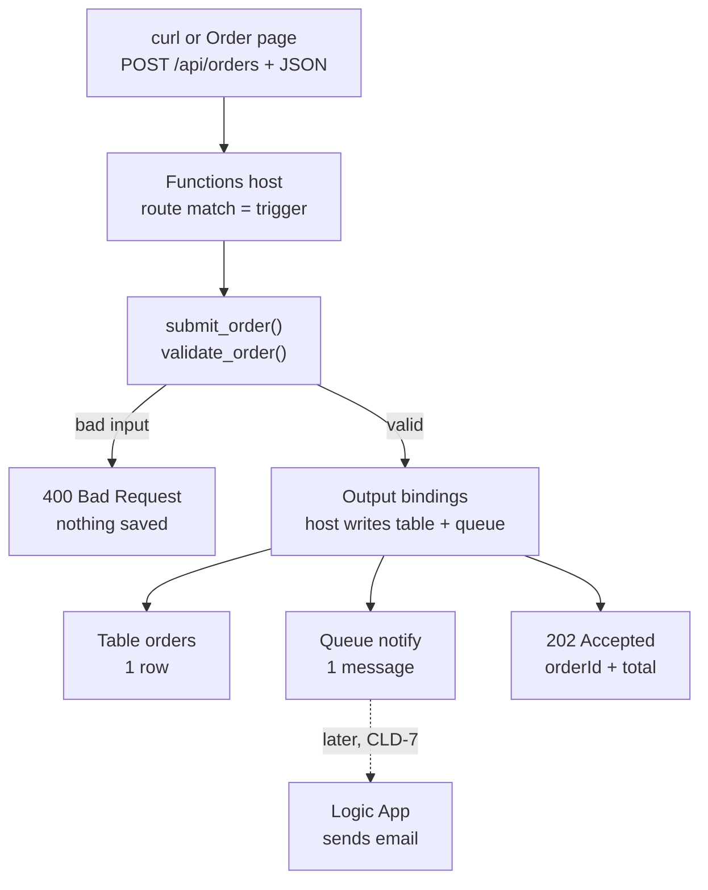

# How `SubmitOrder` works

A plain-language walkthrough of `POST /api/orders` (board item API-3), as built and tested locally on Nov 14, 2026.

## The flow



## 1. What triggers the function

- `func start` runs the Azure Functions host on the laptop (port 7071). In Azure, the Function App runs the same host.
- At start-up the host reads `src/function_app.py` and registers every decorator.
- `@app.route(route="orders", methods=["POST"])` means: a POST to `/api/orders` runs `submit_order`.
- **The URL is the trigger.** No request, no run. That is the event-driven part.

## 2. The request (`curl`)

`curl` stands in for the browser. The Order page on Static Web Apps sends the same request.

```bash
curl -i -X POST http://localhost:7071/api/orders \
  -H "Content-Type: application/json" \
  -d '{"pickupName":"Sam","email":"sam@georgebrown.ca","items":[{"id":"latte","qty":2},{"id":"croissant","qty":1}]}'
```

| Part | Meaning |
|---|---|
| `-X POST` | HTTP method: create something |
| `http://localhost:7071/api/orders` | Which function to trigger |
| `-H "Content-Type: application/json"` | The body is JSON |
| `-d '{...}'` | The order: pickup name, email, items |
| `-i` | Show response status and headers |

## 3. Inside `submit_order`

1. `req.get_json()` reads the body. Not JSON → `400`.
2. `validate_order()` (from `src/core/orders.py`) checks name, email allow-list, menu items and quantities. Any rule broken → `400` with a message.
3. Creates an unguessable `orderId` (`uuid4`) and a UTC timestamp.
4. Calculates the total **on the server** from menu prices. The client never sends prices.
5. Fills the two output envelopes (see below) and returns `202 Accepted`.

## 4. Output bindings: no storage code

```python
@app.table_output(arg_name="order_row", connection="OrdersStorage", table_name="orders")
@app.queue_output(arg_name="notify_msg", connection="OrdersStorage", queue_name="notify")
```

- These decorators are **declarations**: this function may write to table `orders` and queue `notify` through the connection named `OrdersStorage`.
- `order_row` and `notify_msg` are empty envelopes (`func.Out[str]`). The code only fills them with `.set(...)`.
- The **host** writes them to storage after the function finishes. The code never opens a storage connection, never handles keys.
- On the `400` paths the envelopes stay empty, so nothing is written.
- The host also creates the table and queue if they do not exist yet.

## 5. What gets stored

**Table `orders`, one row per order**

| Field | Example |
|---|---|
| `PartitionKey` | `0fd82ffd-ae7c-4db6-ab12-7d60b05f0fb0` (the orderId) |
| `RowKey` | `order` |
| `pickupName` | `Sam` |
| `email` | `sam@georgebrown.ca` (only personal data; never returned or logged) |
| `itemsJson` | `[{"id": "latte", "qty": 2}, {"id": "croissant", "qty": 1}]` |
| `total` | `12.15` |
| `status` / `statusRank` | `Accepted` / `1` |
| `createdAt` / `updatedAt` | `2026-11-14T15:52:23Z` |

**Queue `notify`, one message**

```json
{"orderId": "0fd82ffd-ae7c-4db6-ab12-7d60b05f0fb0", "status": "Accepted", "rank": 1}
```

No email in the message. The worker reads it from the table.

## 6. Why `202`, not `200`

`202 Accepted` means "saved, the rest happens later". The email is sent asynchronously by the Logic App that reads the `notify` queue (CLD-7). The customer does not wait for the email.

## 7. Local vs Azure

| | Local | Azure |
|---|---|---|
| Host | `func start` on port 7071 | Function App `func-campus-cafe-rk` |
| Storage | Azurite (emulator) | `stcampuscaferk` |
| `OrdersStorage` setting | `UseDevelopmentStorage=true` in `local.settings.json` (never committed) | Identity-based settings in the portal, no keys (CLD-5) |
| Code | Same file | Same file |

Only the connection setting changes between environments. The code does not.

## 8. Test results (Nov 14, 2026)

| Test | Expected | Result |
|---|---|---|
| Valid order (2 latte + 1 croissant) | `202`, total `12.15` | ✅ `202`, `12.15` |
| `qty: 0` | `400`, quantity message | ✅ `400` "Quantity must be between 1 and 10." |
| Table and queue | Created by bindings | ✅ `orders` and `notify` appeared in Azurite |
