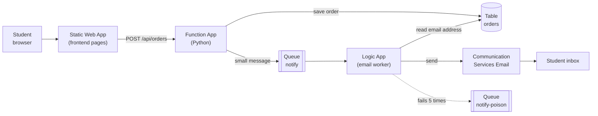

# Start here

Welcome to **Campus Café**, Group 6's Work Integrated Project. This folder explains the project to a teammate who knows the Azure portal but is new to code, VS Code, Git and GitHub.

## What the project does

A student orders coffee on a web page. They get an order ID and an email every time the order moves forward (Accepted → Preparing → Ready). Staff move the order along. Nothing runs (or costs money) when nobody is ordering.

## The architecture in one picture

**Why it is "event-driven":** the website does not wait for the email. The function saves the order, drops a message on a queue and answers right away. The Logic App picks the message up on its own schedule and sends the email. If email is down, messages wait in the queue and nothing is lost.

**Why it is "serverless":** no VMs. Function App, Logic App and Static Web App all scale to zero.

**Why it is "keyless":** every service logs in to the others with a **managed identity** plus an IAM role. No passwords or keys are stored anywhere.

## Read in this order

| # | File | What you learn | Time |
|---|---|---|---|
| 1 | [01-azure-tour.md](01-azure-tour.md) | Every Azure resource, what it does, where to click | 20 min |
| 2 | [02-order-flow.md](02-order-flow.md) | One order, step by step, from click to email | 10 min |
| 3 | [03-code-tour.md](03-code-tour.md) | The Python code, in plain English | 15 min |
| 4 | [04-github-for-beginners.md](04-github-for-beginners.md) | How the repo, branches and pull requests work | 15 min |
| 5 | [05-glossary.md](05-glossary.md) | Every term in one place | Reference |

You can read everything in the **GitHub website**. You do not need VS Code to follow along.

## How the team works

- **One shared GitHub repo** (`imrajankumar95/campus-cafe-serverless`) for code and documents.
- **Each member builds in their own Azure for Students account.** Same design, own resources. Resource names end in your initials (Rajan's end in `-rk`).
- Work is tracked on the board: [docs/board.md](../board.md).
- Big design decisions are written down: [docs/adr/](../adr/).
- The API rules everyone follows: [docs/api.md](../api.md).

## Status (Nov 18, 2026)

| Done | In progress | Next |
|---|---|---|
| Frontend live on Static Web Apps | Email Logic App (retests) | Staff "update status" API |
| Storage, monitoring, Function App | | App settings + CORS in Azure |
| Submit order + get status APIs | | End-to-end test in Azure |
| First real email sent from Azure | | Bicep (infrastructure as code), CI/CD |

Full list: [docs/board.md](../board.md).
