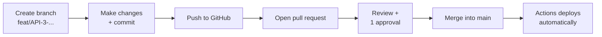

# GitHub for beginners

Everything here works in the **browser**. You do not need Git commands or VS Code to follow the project.

## Git vs GitHub

| | Git | GitHub |
|---|---|---|
| What | A tool that records every version of the files | A website that stores the project online and adds collaboration |
| Like | "Track changes" for a whole folder | OneDrive + track changes + approvals |
| Where | On your laptop | github.com |

## The repo page, tab by tab

Open https://github.com/imrajankumar95/campus-cafe-serverless

| Tab | What it shows | Try this |
|---|---|---|
| **Code** | All files and folders, current version | Click `docs` → `onboarding` (this file) |
| **Commits** (clock icon, top right of the file list) | Every saved change, who made it, when | Open one → green lines added, red lines removed |
| **Pull requests** | Proposed changes, reviews, discussion | **Closed** filter → see every finished change |
| **Actions** | Automatic pipelines (CI/CD) | Green ✅ = website deployed OK |
| **Settings** | Repo rules (owner only) | — |

## Five words you need

| Word | Plain meaning |
|---|---|
| **Commit** | A saved snapshot with a message, e.g. "add submit order function" |
| **Branch** | A private copy to work on without touching the live version |
| **main** | The official version. Always working |
| **Pull request (PR)** | "Please review my branch and add it to main" |
| **Merge** | Accept the PR: the branch's changes join main |

## How a change gets in (our workflow)

- **Nobody can change `main` directly.** A rule on the repo requires a pull request and one approval from someone else. This is how real companies protect production.
- **Branch names say what they are for:** `feat/` new feature, `fix/` bug fix, `docs/` documentation, followed by the board ID (e.g. `feat/API-4-get-order-status`).
- **Your job as a reviewer:** open the PR → **Files changed** tab → read it → **Review changes** → **Approve** (or comment).

## CI/CD (what the Actions tab does)

When a change to `frontend/` is merged into `main`, a GitHub Actions workflow builds the pages and deploys them to the Static Web App. No manual upload. Each open PR also gets its own **preview website**, deleted when the PR closes.

- Workflow file: `.github/workflows/azure-static-web-apps-*.yml`
- It logs in to Azure with **OIDC** (a short-lived token GitHub issues per run), so no long-lived password is stored for that login.

## Editing without Git (small text changes)

1. Open a file on GitHub → pencil icon ✏️.
2. Make the change.
3. **Commit changes** → choose **Create a new branch** → **Propose changes**.
4. GitHub opens a pull request for you. Ask a teammate to approve.

Good for typo fixes in docs. Code changes are better done in VS Code with testing.

## When you are ready for more

- Install **Git** and **VS Code** (with the extensions listed in `.vscode/extensions.json`).
- Learn 6 commands: `git clone`, `git switch`, `git pull`, `git add`, `git commit`, `git push`.
- Ask Rajan for a 20-minute walkthrough.
